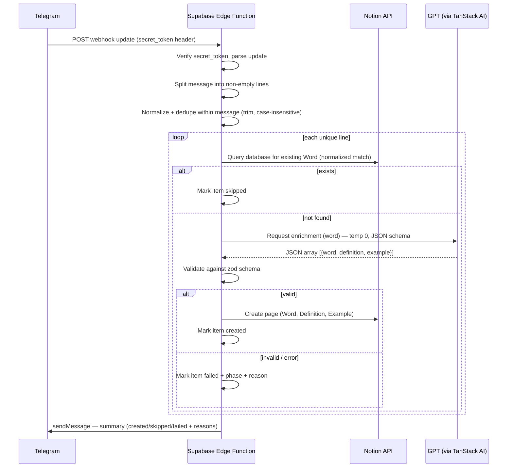

# Spec: Telegram Bot — Vocabulary to Notion

## Objective

Build a Telegram bot that receives one or more English vocabulary items (words, idioms, phrasal verbs) in a chat message, enriches each new item via GPT with a definition and example, and stores it as a row in a Notion database — while skipping items that already exist. The bot runs as a Supabase Edge Function (Deno runtime) triggered by a Telegram webhook.

**User:** A single end user (the vocabulary learner) sending messages to their own private bot.

**Why:** Capture vocabulary on the fly without manual formatting or duplicate entries, keeping one consistent Notion database as the source of truth.

**Success looks like:** All 7 acceptance criteria in [telegram-bot-vocabulary-to-notion.md](../stories/telegram-bot-vocabulary-to-notion.md) pass, deployed and reachable via a live Telegram webhook pointed at a Supabase Edge Function.

---

## Tech Stack

| Concern           | Choice                                                                                                                                                                           |
| ----------------- | -------------------------------------------------------------------------------------------------------------------------------------------------------------------------------- |
| Language          | TypeScript (Deno-native type checking via `deno check`; no standalone `tsc` flow)                                                                                                |
| Runtime           | Deno (latest stable compatible with Supabase Edge Functions)                                                                                                                     |
| Hosting           | Supabase Edge Functions                                                                                                                                                          |
| GPT client        | `@tanstack/ai` (core) + `@tanstack/ai-gemini` (adapter)                                                                                                                          |
| Notion client     | `@notionhq/client` (Notion SDK)                                                                                                                                                  |
| Telegram client   | `node-telegram-bot-api` — used strictly for typed request/response shapes and `sendMessage`/`sendChatAction`-style calls. **Never** `.startPolling()` (see Architecture, below). |
| Utility library   | `remeda` for collection/string/object transforms where practical; avoid ad hoc utility helpers when a Remeda function exists                                                     |
| Schema validation | `zod` (already a peer dependency of `@tanstack/ai`)                                                                                                                              |
| Env/secrets       | `.env` locally (via Supabase CLI `--env-file`), Supabase project secrets in production                                                                                           |

Dependency versions are pinned via `npm:` specifiers in `deno.json` (`imports` map), e.g. `"npm:@notionhq/client@^3"`. Exact versions are locked at implementation time via `deno.lock`.

---

## Architecture



**Why webhook, not polling:** Supabase Edge Functions are stateless, per-request invocations with execution time limits. `node-telegram-bot-api`'s polling mode requires a long-lived process (`setInterval`/`getUpdates` loop), which cannot run inside an Edge Function. The bot must be registered with Telegram via `setWebhook` (a one-time setup step, not part of the running function), and the Edge Function acts purely as the webhook HTTP handler.

**Determinism for GPT output:** Use `temperature: 0` via the `@tanstack/ai-gemini` adapter, require JSON response mode (`responseMimeType: application/json`), and validate with zod schema (`z.array(z.object({ word, definition, example })).length(1)`) as the source of truth. Reject and treat as a GPT-format-validation failure if the schema doesn't match — never partially insert.

**Notion duplicate check:** Query the database filtering on the `Word` title property. Normalize both the incoming value and the fetched values by `trim()` + case-insensitive comparison (`toLocaleLowerCase()`), without collapsing internal whitespace, before comparing.

---

## Commands

```bash
# Local dev — serve the function with env vars loaded
supabase functions serve telegram-vocab-bot --env-file .env --no-verify-jwt

# Type-check
deno check supabase/functions/telegram-vocab-bot/index.ts

# Lint
deno lint

# Format
deno fmt

# Run tests
deno test --allow-env --allow-net supabase/functions/telegram-vocab-bot

# Push secrets to the deployed project
supabase secrets set --env-file .env

# Deploy
supabase functions deploy telegram-vocab-bot --no-verify-jwt

# One-time: register the webhook with Telegram (manual step)
curl -X POST "https://api.telegram.org/bot$TELEGRAM_BOT_TOKEN/setWebhook" \
  -d "url=$FUNCTION_URL" \
  -d "secret_token=$TELEGRAM_WEBHOOK_SECRET"
```

---

## Project Structure

```text
supabase/
  functions/
    telegram-vocab-bot/
      index.ts            → HTTP entrypoint: webhook signature check, dispatch to pipeline
      parseMessage.ts      → line splitting, blank-line filtering, normalize + in-message dedupe
      notion.ts             → Notion client wrapper: findByWord(), createRow()
      gpt.ts                 → TanStack AI client wrapper: enrich(word) -> validated {word, definition, example}
      telegram.ts          → sendMessage helper (fetch-based or node-telegram-bot-api typed call)
      pipeline.ts           → orchestrates per-item processing + summary aggregation
      schema.ts             → zod schemas (GPT response, Notion row shape)
      types.ts               → shared TS types
      *_test.ts               → colocated Deno tests per module
deno.json                    → import map, compiler options, tasks
.env.example                → documented, empty-valued keys
.env                             → local secrets (gitignored)
docs/
  specs/
    telegram-bot-vocabulary-to-notion.md   → this file
  stories/
    telegram-bot-vocabulary-to-notion.md   → source user story
```

---

## Environment Variables

`.env.example` (create with empty values):

```bash
# Telegram
TELEGRAM_BOT_TOKEN=
TELEGRAM_WEBHOOK_SECRET=

# Notion
NOTION_API_KEY=
NOTION_DATABASE_ID=

# Gemini (via @tanstack/ai-gemini)
GEMINI_API_KEY=
GEMINI_MODEL=

# Supabase (for local Deno process to know its own deployed URL, used only by the manual webhook-registration step)
FUNCTION_URL=
```

`.env` is gitignored; never committed. `TELEGRAM_WEBHOOK_SECRET` is compared against Telegram's `X-Telegram-Bot-Api-Secret-Token` header on every incoming request — reject with `401` if missing/mismatched, before any parsing.

Recommended model value for `GEMINI_MODEL`: a low-cost option such as `gemini-2.5-flash-lite`.

---

## Code Style

Conventions:

- 2-space indent, semicolons, double quotes (Deno `fmt` defaults — do not override).
- Explicit return types on exported functions.
- `npm:` specifiers version-pinned in `deno.json`, never bare `npm:package` without a version.
- No default exports; named exports only.
- Prefer `remeda` utilities for transformations (e.g., `map`, `filter`, `uniqBy`, `pipe`) instead of new one-off helper utilities.
- Errors are typed discriminated unions per phase (see below), not thrown strings.

```ts
type PhaseError =
  | { phase: "parsing"; reason: string }
  | { phase: "notion_lookup"; reason: string }
  | { phase: "gpt_request"; reason: string }
  | { phase: "gpt_validation"; reason: string }
  | { phase: "notion_insert"; reason: string };
```

---

## Testing Strategy

- **Framework:** Deno's built-in test runner (`Deno.test`), files named `*_test.ts` colocated next to the module under test.
- **Unit tests:**
  - `parseMessage_test.ts` — blank lines, whitespace-only lines, in-message duplicate normalization (trim + case-insensitive, inner spaces preserved).
  - `schema_test.ts` — zod schema accepts valid GPT payload, rejects missing fields / wrong types / extra array length.
- **Integration tests (mocked boundaries):** `notion_test.ts` and `gpt_test.ts` stub `fetch` (via `Deno.test` + manual fetch override or `std/testing/mock`) to assert request shape and response parsing without hitting real APIs.
- **Pipeline tests:** `pipeline_test.ts` — feeds a multiline message through the full flow with mocked Notion/GPT to assert: correct created/skipped/failed counts, continuation after one item fails, per-item failure reason attached to the right phase.
- **No live network calls in CI.** Real Notion/GPT/Telegram calls are only exercised manually via `supabase functions serve` against a test Notion database.
- **Coverage expectation:** all acceptance criteria in the user story must map to at least one test; no formal % target given single-user/small-codebase scope.

---

## Boundaries

- **Always do:**
  - Validate GPT output against the zod schema before any Notion write.
  - Normalize `Word` (trim + case-insensitive) identically on read and write paths.
  - Verify `X-Telegram-Bot-Api-Secret-Token` before processing any webhook payload.
  - Continue processing remaining items in a batch after a single item fails.
  - Keep secrets only in `.env` (local) / Supabase secrets (deployed) — never inline in source.

- **Ask first:**
  - Changing the Notion database schema (property names/types).
  - Adding any dependency not already listed in Tech Stack.
  - Switching Telegram library away from `node-telegram-bot-api` (e.g., to raw fetch or `grammY`) if it proves incompatible with Deno/Edge at implementation time.
  - Changing GPT provider/model or temperature away from deterministic (temp 0) settings.

- **Never do:**
  - Commit `.env` or any real API key/token.
  - Call Telegram `.startPolling()` in the Edge Function.
  - Insert a Notion row without a validated GPT response.
  - Log full secrets or full user message content containing tokens in error output.

---

## Success Criteria

- All 7 acceptance criteria in the source user story pass against a real Telegram bot, real Notion database, and real GPT call (manual verification), plus automated tests for the logic layers listed above.
- `deno check`, `deno lint`, and `deno test` all pass with zero errors.
- Sending a duplicate word (by normalized match) never triggers a GPT call (verifiable via mocked test asserting `gpt.enrich` not called).
- A batch with one intentionally malformed/failing item still reports correct per-item summary and other items remain saved in Notion.
- `.env.example` lists every key required to run the project locally with empty values, and the project fails fast (clear error) if a required key is missing at startup.

---

## Open Questions

1. **`node-telegram-bot-api` in Deno/Edge:** This package is Node-oriented (uses Node's `EventEmitter`, historically `request`/`form-data`). It is used here only for typed `sendMessage`-style calls, never for polling. If it fails to load under Deno's `npm:` compatibility layer at implementation time, fallback is a raw `fetch` call to `https://api.telegram.org/bot<token>/sendMessage`.

## Confirmed Decisions

- Use `remeda` broadly instead of inventing custom utility helpers.
- Use Deno's built-in TypeScript checker (`deno check`) as the canonical type-check path.
- Keep webhook registration as a manual step.
- Fix Notion property names to `Word`, `Definition`, and `Example`.
